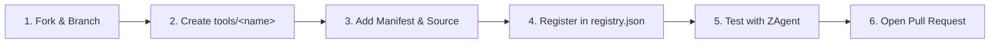

# Contributing to ZTools

Welcome to the **ZTools** open ecosystem! 🎉

ZTools is the official open-source tool registry for [ZAgent](https://github.com/ranjanlive/zagent) and the [ZEngine](https://github.com/ranjanlive) autonomous agent architecture. We believe the future of autonomous software engineering and automation is powered by a rich, modular community of reliable tools.

Whether you want to build a tool that integrates a new cloud provider, automates a browser, parses ASTs, inspects device logs, runs Docker containers, or generates assets—**we welcome your contribution!**

---

## 🌟 What is a ZTool?

A **ZTool** is a self-contained executable, script, or CLI utility accompanied by a declarative JSON manifest that teaches AI agents how and when to invoke it.

- **Language-Agnostic:** Write your tool in **Go, Rust, Python, Node.js/TypeScript, C++, Shell, Ruby**, or any executable format.
- **Protocol-Driven:** Tools communicate with ZAgent via standardized standard I/O (JSON over `stdin` / `stdout`).
- **Safe & Sandboxed:** Operates strictly within the user's workspace context with customizable timeouts.

---

## 🚀 Quick Contribution Flow



---

## 🛠️ Step-by-Step Guide: Creating a New Tool

### Step 1: Fork and Clone the Repository

1. Fork the [ZTOOLS repository](https://github.com/ranjanlive/ZTOOLS) on GitHub.
2. Clone your fork locally:
   ```bash
   git clone https://github.com/<your-username>/ZTOOLS.git
   cd ZTOOLS
   git checkout -b feat/add-my-awesome-tool
   ```

### Step 2: Create Your Tool Directory

Create a dedicated directory under `tools/` with your tool's snake_case or kebab-case name:

```
tools/my_awesome_tool/
├── my_awesome_tool.json    # The ZAgent tool manifest (Required)
├── README.md               # Documentation & usage examples (Required)
├── main.go                 # Source code (or index.js, tool.py, etc.)
└── ...                     # Supporting files, tests, templates
```

### Step 3: Author the Tool Manifest (`my_awesome_tool.json`)

The manifest defines the tool's schema, arguments, descriptions, and execution parameters. For full specifications, see [TOOL_SPECIFICATION.md](TOOL_SPECIFICATION.md).

```json
{
  "name": "my_awesome_tool",
  "description": "Clear explanation of what the tool accomplishes and when the agent should choose it over other tools.",
  "parameters": {
    "type": "object",
    "required": ["target_file"],
    "properties": {
      "target_file": {
        "type": "string",
        "description": "Path to the file to process (relative to agent workspace)."
      },
      "verbose": {
        "type": "boolean",
        "description": "Enable detailed progress logging. Defaults to false."
      }
    },
    "additionalProperties": false
  },
  "command": ["{dir}/my_awesome_tool", "--agent-json"],
  "input": "stdin_json",
  "output": "json",
  "timeout_seconds": 60,
  "platforms": ["windows", "linux", "darwin"]
}
```

> [!NOTE]
> `{dir}` is dynamically replaced by ZAgent with the directory where the tool binary lives.

### Step 4: Implement the CLI Protocol

Your tool must obey the **ZAgent Standard Tool Protocol**:

1. **Input via STDIN:** When `"input": "stdin_json"`, ZAgent passes arguments as a JSON object into your tool's `stdin`.
2. **Output via STDOUT:** When `"output": "json"`, your tool must write a JSON response to `stdout`:
   ```json
   {
     "output": "Summary of execution or generated content string",
     "is_error": false,
     "media": []
   }
   ```
3. **Exit Codes:**
   - Exit code `0`: Tool ran and handled the request (even if application-level error occurred, reported via `is_error: true`).
   - Non-zero exit code: Catastrophic tool crash or internal panic.

### Step 5: Test Locally

Test your tool standalone:
```bash
# Provide test JSON via stdin
echo '{"target_file": "test.txt"}' | ./my_awesome_tool --agent-json
```

Test directly with the **ZAgent CLI**:
```bash
zagent tools run my_awesome_tool --args '{"target_file": "test.txt"}'
```

### Step 6: Register Your Tool in `registry.json`

Add an entry to the `tools` array in the root [registry.json](registry.json):

```json
{
  "id": "my_awesome_tool",
  "name": "My Awesome Tool",
  "version": "1.0.0",
  "description": "Concise 1-2 sentence description for the showcase catalog.",
  "category": "developer-tools",
  "author": {
    "name": "Your Name",
    "github": "yourusername",
    "url": "https://github.com/yourusername"
  },
  "license": "Apache-2.0",
  "icon": "terminal",
  "tags": ["formatting", "code-gen", "automation"],
  "manifest_path": "tools/my_awesome_tool/my_awesome_tool.json",
  "source_url": "https://github.com/ranjanlive/ZTOOLS/tree/main/tools/my_awesome_tool",
  "platforms": ["windows-amd64", "linux-amd64", "darwin-arm64"],
  "install_command": "zagent tools install my_awesome_tool",
  "sample_call": {
    "target_file": "src/main.rs"
  }
}
```

Validate your change against the schema:
```bash
# Using any JSON Schema validator, or PowerShell:
Test-Json -Path registry.json -SchemaFile registry.schema.json
```

---

## 🚫 Critical Repository Rules

> [!WARNING]
> **DO NOT commit compiled binaries (`.exe`, `.dll`, `.so`, `bin/`) or compressed zip archives directly into git tracking!**
> Committing binaries causes git repository bloat. Binaries should either:
> 1. Be compiled on-demand from source by users, or
> 2. Be published as GitHub Release assets attached to release tags (contact the maintainers or use our release workflow).

> [!IMPORTANT]
> **Workspace Safety:** Tools must strictly operate within the path designated by the user's workspace. Tools that execute arbitrary destructive modifications outside the workspace (such as modifying system directories or unapproved network backdoors) will be rejected.

---

## 📋 Pull Request Checklist

Before submitting your PR, verify the following:

- [ ] Directory created under `tools/<tool_name>/`.
- [ ] Manifest `<tool_name>.json` is valid JSON and contains all required fields (`name`, `description`, `parameters`, `command`, `timeout_seconds`).
- [ ] `README.md` included with tool installation instructions, usage examples, and license.
- [ ] Added an entry to `registry.json` conforming to `registry.schema.json`.
- [ ] Verified locally with `Test-Json` or standard JSON schema validator.
- [ ] No compiled binaries or `.zip` files are staged in the git commit.
- [ ] Tool passes basic tests / unit tests.

---

## 💬 Community & Help

- **Issues & Proposals:** If you're designing a complex tool, open an issue using the [New Tool Proposal](https://github.com/ranjanlive/ZTOOLS/issues/new?template=new_tool_proposal.md) template.
- **Maintainer:** Rajeev Ranjan ([@ranjanlive](https://github.com/ranjanlive)).
- **Companion Repositories:**
  - [ZAgent Core](https://github.com/ranjanlive/zagent)
  - [ZSched Task Scheduler](https://github.com/ranjanlive/zsched)
