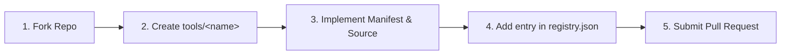

# ZTools: Open Tool Registry for ZAgent & ZEngine

[](LICENSE)
[](https://github.com/ranjanlive/ZTOOLS/stargazers)
[](registry.json)
[](#supported-platforms)
[](https://ranjanlive.github.io/ZTOOLS/)

**ZTools** is the official open-source tool registry and capability ecosystem for [ZAgent](https://github.com/ranjanlive/zagent) and the [ZEngine](https://github.com/ranjanlive) autonomous agent architecture.

Autonomous AI agents are only as powerful as the tools they wield. ZTools provides a curated, verified, and community-driven collection of specialized CLI tools, browser bridges, scrapers, project generators, and AI integrations—each accompanied by a standard machine-readable manifest.

Explore the dynamic web catalog live at **[ranjanlive.github.io/ZTOOLS](https://ranjanlive.github.io/ZTOOLS/)**.

---

## 🧭 Featured Tools Catalog

| Tool | Category | Version | Platforms | Description |
|---|---|---|---|---|
| **[android_project_scaffold](tools/android_project_scaffold)** | Mobile | `1.0.0` | Win, Linux, Mac | Offline Kotlin & Jetpack Compose Android app generator with pinned stable toolchain & Material 3 templates. |
| **[web_search](tools/zpilot_browser_cli/web_search)** | Search | `2.0.0` | Win, Linux, Mac | Search Google, Bing, DuckDuckGo, Brave, or Yahoo directly via your authenticated browser session. |
| **[webpage_read](tools/zpilot_browser_cli/webpage_read)** | Browser | `2.0.0` | Win, Linux, Mac | Read JavaScript-rendered web pages, returning distraction-free Markdown, text, and extracted links. |
| **[zagent_in_chrome](tools/zpilot_browser_cli/zagent_in_chrome)** | Browser | `2.0.0` | Win, Linux, Mac | Direct browser automation bridge: click, type, navigate, screenshot, and inspect DOM inside Chrome. |
| **[generate_image](tools/zpilot_browser_cli/generate_image)** | AI & Media | `2.0.0` | Win, Linux, Mac | Generate and edit high-resolution images via ChatGPT / DALL-E directly in the user's browser session. |
| **[generate_music](tools/zpilot_browser_cli/generate_music)** | AI & Media | `2.0.0` | Win, Linux, Mac | Synthesize custom musical tracks and background scores with Gemini audio generation models. |

---

## ⚡ Quickstart: Using Tools with ZAgent

### 1. Download or Install a Tool

You can install tools directly from the registry using ZAgent:

```bash
# Install a tool from this registry
zagent tools install android_project_scaffold

# Or install the ZPilot browser automation tool suite
zagent tools install web_search webpage_read zagent_in_chrome
```

Or download pre-compiled platform binaries directly from [GitHub Releases](https://github.com/ranjanlive/ZTOOLS/releases).

### 2. Run a Tool Standalone

Every ZTool can be executed directly from your terminal or test script:

```powershell
# Run Android project scaffold
zagent tools run android_project_scaffold --args '{
  "name": "MySuperApp",
  "package": "com.example.superapp",
  "output": "./MySuperApp"
}'

# Perform a web search
zagent tools run web_search --args '{
  "query": "Go concurrency best practices",
  "engine": "google",
  "result_count": 5
}'
```

---

## 🤝 How Public Contributors Can Add New Tools

We actively encourage and welcome tools built in **any language** (Go, Rust, Python, Node.js, Bash, C++, etc.)!



### Quick Contribution Steps

1. **Fork the Repository:** Fork [ranjanlive/ZTOOLS](https://github.com/ranjanlive/ZTOOLS) and create a feature branch (`git checkout -b feat/my-tool`).
2. **Add Your Tool Folder:** Create `tools/<tool_name>/` containing:
   - `<tool_name>.json`: The declarative tool manifest.
   - `README.md`: Documentation and quickstart.
   - Source code and build scripts.
3. **Register in `registry.json`:** Add your tool metadata to `registry.json` matching the schema in `registry.schema.json`.
4. **Submit a Pull Request:** Open a PR against `main`! Our automated GitHub Action validates the manifest and catalog schema.

📖 **Detailed Guides:**
- Read the **[Contributing Guide (CONTRIBUTING.md)](CONTRIBUTING.md)** for conventions and checklists.
- Read the **[Tool Protocol Specification (TOOL_SPECIFICATION.md)](TOOL_SPECIFICATION.md)** for wire formats, arguments, and exit codes.

---

## 🌐 Dynamic Registry Architecture

The root file [`registry.json`](registry.json) serves as the single source of truth for:
1. **The Dynamic Showcase Webpage** ([ranjanlive.github.io/ZTOOLS](https://ranjanlive.github.io/ZTOOLS/)) which dynamically renders tool cards, parameter schemas, and download links.
2. **ZAgent Package Manager** which fetches and installs tools into your local agent environment.

---

## 🔗 The ZEngine Ecosystem

- **[ZAgent](https://github.com/ranjanlive/zagent):** Autonomous agent engine with multi-model intelligence, dynamic tool execution, and reactive planning.
- **[ZSched](https://github.com/ranjanlive/zsched):** Background task daemon, recurring cron engine, and system tray monitor for autonomous agents.
- **[ZTools](https://github.com/ranjanlive/ZTOOLS):** Official tool registry and ecosystem (this repository).

---

## 📄 License

This repository is licensed under the [Apache License 2.0](LICENSE).  
Copyright © 2026 Rajeev Ranjan.
