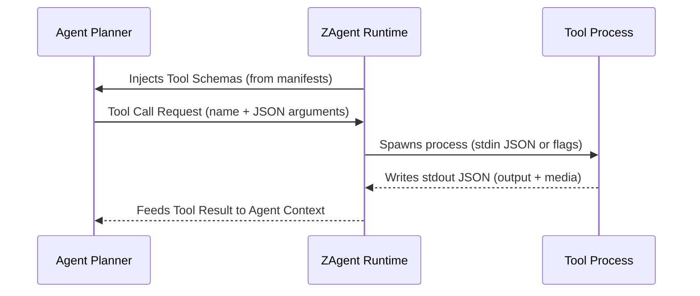

# ZAgent Tool Protocol Specification (v1.0)

This document specifies the standard contract for external tools in the **ZAgent** and **ZEngine** agentic architectures.

Any tool conforming to this specification can be discovered, declared, validated, and executed automatically by autonomous LLM planners.

---

## 1. Tool Architecture Overview

ZAgent tools are decoupled standalone executables. The agent runtime discovers tools by scanning directories containing `.json` manifests:



---

## 2. Tool Manifest Schema (`<tool_name>.json`)

Each tool must have a corresponding `<tool_name>.json` file.

### Required Fields

| Field | Type | Description |
|---|---|---|
| `name` | `string` | Unique identifier (lowercase alphanumeric + underscores/hyphens, e.g. `web_search`). |
| `description` | `string` | Human and model-readable explanation of what the tool accomplishes. |
| `parameters` | `object` | JSON Schema draft-07 object describing the parameters the agent must provide. |
| `command` | `string[]` | Command arguments used to spawn the tool process. Supports `{dir}` macro. |
| `input` | `string` | Mode of passing inputs: `"stdin_json"` (recommended) or `"flags"`. |
| `output` | `string` | Expected format: `"json"` (recommended) or `"text"`. |
| `timeout_seconds` | `integer` | Maximum execution time before ZAgent kills the process. |

### Optional Fields

| Field | Type | Description |
|---|---|---|
| `cwd` | `string` | Working directory: `"workspace"` (default) or `"tool_dir"`. |
| `platforms` | `string[]` | Array of supported OS: `["windows", "linux", "darwin"]`. |
| `background` | `boolean` | Whether the tool is launched asynchronously as a long-running daemon. |
| `attach_outputs` | `boolean` | When true, stdout/stderr are captured and forwarded in real-time. |

### Example Manifest

```json
{
  "name": "android_project_scaffold",
  "description": "Create a new Kotlin/Jetpack Compose Android project offline using an embedded stable toolchain.",
  "parameters": {
    "type": "object",
    "required": ["name", "package", "output"],
    "additionalProperties": false,
    "properties": {
      "name": {
        "type": "string",
        "minLength": 1,
        "maxLength": 80,
        "description": "App display/project name."
      },
      "package": {
        "type": "string",
        "pattern": "^[a-z][a-z0-9_]*(\\.[a-z][a-z0-9_]*)+$",
        "description": "Android application package ID."
      },
      "output": {
        "type": "string",
        "description": "Output path inside the workspace."
      },
      "min_sdk": {
        "type": "integer",
        "minimum": 26,
        "maximum": 37,
        "default": 26,
        "description": "Minimum API level."
      }
    }
  },
  "command": ["{dir}/android_project_scaffold", "--json"],
  "input": "stdin_json",
  "output": "json",
  "timeout_seconds": 30,
  "platforms": ["windows", "linux", "darwin"]
}
```

---

## 3. Communication Protocols

### 3.1 Input Delivery (`stdin_json`)

When `"input": "stdin_json"` is configured, ZAgent starts the process and pipes a single JSON object to the tool's `stdin`:

```json
{
  "name": "MySampleApp",
  "package": "com.example.app",
  "output": "./sample-app",
  "min_sdk": 26
}
```

The tool should read `stdin` until EOF and deserialize it using its schema.

### 3.2 Output Wire Format (`output: "json"`)

When the tool finishes, it writes a JSON object to `stdout`:

```json
{
  "output": "Successfully scaffolded Kotlin Android project at ./sample-app with 18 files.",
  "is_error": false,
  "media": [
    {
      "mime_type": "image/png",
      "path": "sample-app/preview.png",
      "caption": "Project structure preview"
    }
  ]
}
```

#### Fields

- `output` (`string`, required): Formatted text or Markdown presented directly to the agent LLM planner.
- `is_error` (`boolean`, optional): Set to `true` if an error occurred during execution (e.g. invalid arguments, missing dependency, compilation failure).
- `media` (`array`, optional): Array of multi-modal media references (images, audio, artifacts) generated by the tool.

### 3.3 CLI Exit Codes

- `0`: Execution completed normally. The runtime inspects `is_error` in the JSON response to determine logical status.
- `Non-Zero`: Process crashed, segmentation fault, killed by signal, or threw an unhandled exception.

---

## 4. Standard Environment Variables

ZAgent sets the following environment variables for child tool processes:

| Variable | Description |
|---|---|
| `ZAGENT_WORKSPACE` | Absolute path to the user's active workspace root. |
| `ZAGENT_TOOL_DIR` | Absolute path to the directory containing the tool binary. |
| `ZAGENT_RUN_ID` | Unique identifier for the agent session or execution run. |
| `ZAGENT_TOOL_NAME` | The registered name of the tool. |

---

## 5. Security & Sandbox Boundaries

1. **Workspace Containment:** Tools MUST NOT write, modify, or delete files outside the directory indicated by `ZAGENT_WORKSPACE`.
2. **Credential Redaction:** If a tool accesses external credentials, it must sanitize and redact tokens before returning them in `output` or stdout logs.
3. **Graceful Cancellation:** When the runtime cancels a tool, it issues `SIGINT` (or `CTRL_C_EVENT` on Windows). The tool should flush buffers, cleanup temporary files, and terminate within 2 seconds.
